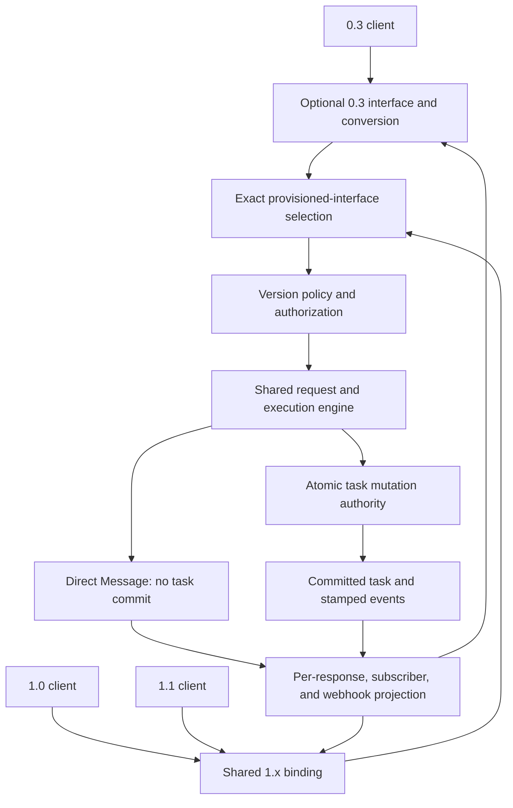

# Three protocol interfaces, one task engine

Status: previously reviewed server architecture; client scope revision proposed on
2026-11-10 and requiring review alongside the retained server decisions.
No runtime support is implemented.
Prepared 2026-11-09 against SDK `2817ed78d` (research commit above
`b96e0b3f2`) and the pinned specification revisions in [README](README.md).

## Outcome and agreed constraints

One a2a-java instance can provision 0.3, 1.0, and 1.1 server interfaces together,
over JSON-RPC, REST, and gRPC. A client requesting 1.0 receives the 1.0 server
contract; a client requesting 1.1 receives the 1.1 server contract. Unprovisioned
versions are rejected, never silently redirected to another version.

The user confirmed:

- This goal delivers an architecture for review and a concrete prompt for a
  later implementation loop. Production implementation is a separate task.
- Preserve common application APIs. Documented custom-store and executor
  migrations are acceptable where necessary for 1.1.
- All three server interfaces must be serviceable from one instance when
  provisioned. Existing 0.3 support remains optional.
- Later implementation runs are bounded by ten focused iterations or two hours,
  with at most three attempts at the same failing criterion before reporting
  the obstacle. Reaching a limit does not satisfy acceptance criteria.

The user expanded the scope on 2026-11-10 to production 1.1 SDK client support
through public APIs over JSON-RPC, REST, and gRPC. Client and server capabilities
must arrive together with integration tests. The user also selected **1.1 as the
client default** and requested a design that is easy to improve later. Explicit
1.0 instances retain their contract. The default change for rebuilt applications
is intentional and documented; preserving common signatures does not imply
preserving the previous implicit 1.0 selection. Historical binaries/fixtures
remain independent compatibility peers. Automatic discovery-driven version
negotiation/fallback and general release work remain outside scope.

## Architecture decision

Evolve the shared domain model and task engine to support 1.1. Keep the existing
optional 0.3 modules and translate directly into that core. Implement explicit
1.0 and 1.1 protocol policies at the shared 1.x transport boundary.

| Alternative | Assessment |
| --- | --- |
| Shared core with explicit version interfaces | Recommended: one task lifecycle, focused compatibility policies, existing transport reuse. |
| Full `compat-1.0/` types, generated classes, mappers, transports | Freezes old Java types independently, but duplicates mostly additive models and still needs shared lifecycle invariants. The agreed Java API constraint does not justify it. |
| Independent 1.0 and 1.1 task engines | Isolates behavior but duplicates execution and persistence and makes shared task access difficult. Reject for this design. |

### Provisioning and dependency boundaries

Keep 1.0 compatibility built into the shared 1.x implementation. Make its
exposure selectable, rather than creating a second Maven protocol stack merely
to make it optional. Adding a third policy to a shared boundary is substantially
smaller than duplicating the server.

The effective endpoint/tenant registration selects enabled protocol versions.
Agent Card entries and dispatch must derive from the same registration, so
advertised and reachable interfaces cannot drift. The final configuration name
belongs in the later implementation plan; this document defines its behavior.

| Provisioned interfaces | Expected behavior |
| --- | --- |
| 1.1 only | 1.1 accepted; explicit 1.0 and 0.3 rejected. No 0.3 modules required. |
| 1.0 only | Existing 1.0 behavior; explicit 1.1 and 0.3 rejected. |
| 1.0 + 1.1 | Both exact contracts served by the shared 1.x stack. |
| 0.3 + 1.0 + 1.1 | All three exact contracts served from one application, with optional 0.3 modules installed. |

Other subsets, including 0.3 alone and 0.3 with either 1.x version, follow the
same rule. Enabling 0.3 without its modules fails configuration clearly. Core
1.x artifacts must not acquire a transitive dependency on 0.3 artifacts.
Existing deployments keep their current enabled interfaces by default; adding
the library upgrade alone must not start advertising 1.1.

"1.1 becomes primary" refers to the canonical domain model and handler, not
automatic endpoint exposure or the meaning of a missing version header.
For new configurations using the new interface-registration API, require an
explicit nonempty version set; an omitted set is a configuration error. New
examples should explicitly provision `{1.1}`. Add 1.0 explicitly when desired,
and add 0.3 explicitly together with its optional modules. Existing entry points
and configuration adapters retain their historical exposure defaults; do not
guess whether a deployment is new from stored tasks or a library version.

For a newly registered HTTP endpoint, an absent/blank version still resolves to
0.3 and is rejected if 0.3 is not provisioned. Apply the same missing/blank-to-0.3
rule to gRPC metadata, as required by the pinned RC and already implemented by
`A2AVersionValidator`. The `lf.a2a.v1` service name does not imply a 1.0 version
default: if the selected service/interface cannot provide the requested 0.3
contract, reject it even when a separate 0.3 service is installed on that port.
Test absent, empty, and whitespace-only metadata independently. A previously
proven historical exception may live in an explicitly named legacy adapter with
regressions; no new shared-registration exception is introduced. In particular,
a 1.1-only registration never interprets an absent version as 1.1.

### Request and response flow

The diagram represents logical boundaries, not mandatory new modules.

Select the interface using requested version, binding, endpoint, and effective
tenant card. Preserve HTTP header/query precedence and the existing absent
version rule: the multi-version HTTP router resolves absence to 0.3; if that
interface is not installed/enabled, reject instead of choosing 1.1. Record and
test single-version entry-point defaults separately. The gRPC context can carry
a null version despite a comment suggesting a current-version default; the
validator normalizes that null to 0.3. Verify the full path, not the comment.

Keep the original protocol version in `ServerCallContext`, including after
0.3 conversion. Do not infer semantics from the current SDK version constant.
Use an immutable selected policy for the entire request/subscription.

The selected policy owns operation availability, parameter semantics, logical
error-to-binding mapping, and output projection. Authorization remains an
independent requirement at every version. Filtering a response grants no access.

### Binding and discovery rules

For HTTP, exact-version selection may share the URL or use separate configured
URLs. Do not require a separate process or duplicate core to expose an interface.
For gRPC, 0.3 retains `a2a.v1`; both 1.x versions share
`lf.a2a.v1.A2AService`. Register that 1.x service once and select the exact
contract from metadata and provisioning. Gate the added live RPC accordingly.

Advertise explicit 1.0 and 1.1 interfaces when both are enabled. This follows
the RC prose permitting multiple interfaces and the SDK's exact-minor validator.
The conflicting proto comment recommending only the latest minor is tracked
in the specification gate below. Discovery must not advertise 1.1 as an implicit
promise to serve any 1.x minor.

## Compatibility policy

### Models and Java extension points

Released protocol schemas are immutable versioned contracts. Keep the exact
1.0 schema/client fixtures and, once released, the exact frozen 1.1 schema.
The shared runtime recommendation generates once from the selected 1.1 schema;
it does not construct a hand-edited hybrid or rewrite the frozen 1.0 contract.
Validate interoperability using independently generated 1.0 clients. Separate
runtime-generated types remain an alternative if compatibility evidence requires
them; freezing the source schemas alone does not require two registered 1.x
services with the same protobuf service name.

Retain the current shared `org.a2aproject.sdk.spec` model; extend records,
builders, Gson adapters, and protobuf mapping together. Preserve existing common
constructor signatures, builder defaults except the explicitly changed client
protocol default, method signatures, and non-null accessor contracts. In particular, keep `MessageSendParams.message()` non-null:
making it nullable would break ordinary callers even if its old constructor
still existed. Represent artifact-only input through a new companion boundary
shape with conditional validation and map message-bearing input to the existing
API. The wire request need not be the same Java type used by every old caller.

Publish an API compatibility report. Adding records/components or event kinds
can affect equality, reflection, serialization, and exhaustive sealed switches;
constructor overloads do not settle these questions. Seek an explicit decision
on any concrete common-API break that cannot be avoided. The user's accepted
migration exception covers custom stores/executors, not a blanket rewrite of
ordinary caller APIs or custom handlers.

Use a dedicated subscription parameter type/entry point for the cursor rather
than adding replay options to every ID-only operation. Keep existing handler
methods callable with their old behavior; introduce new operations through
documented defaults or companion interfaces where appropriate. A default
unsupported implementation preserves linking, but cannot be advertised as a
working 1.1 streaming implementation.

Preserve existing custom-handler methods through compatible adapters/defaults.
Changes to stores and executors must have migration examples and explicit
runtime capability checks. Never implement atomic compare-and-mutate as an
unprotected default `get()` followed by `save()`.

### Older-client views of shared tasks

Proposed policy: task identity is independent of protocol version, subject to
the same tenant and authorization checks. 0.3/1.0 can observe a task also used
by 1.1, through an intentionally reduced view. This is a design recommendation,
not a separately confirmed user constraint.

- Preserve established history and history-length rules alongside the timeline.
- Omit 1.1-only fields in old JSON views and omit new event kinds before old
  conversion/serialization. Apply the same policy to unary/list responses,
  snapshots, streams, and webhooks.
- Hide user-origin artifacts and their updates from 0.3/1.0 views. Never remove
  their role and present them as agent output. Agent-origin artifacts remain
  visible. Legacy absence of role is interpreted as agent origin.
- Preserve origin across updates. By default reject cross-origin replacement or
  append; do not silently permit an old agent output to overwrite hidden client
  input using a colliding artifact ID. Reconcile this rule with the pinned final
  specification before implementing it.
- Document that an older view is incomplete when a task uses user artifacts.
  Do not claim a lossless downgrade of all 1.1 features.

Dropping events must respect `Flow` demand: skipped events do not consume the
downstream request budget. Preserve ordering, cancellation, failure, and finality
when every intermediate event is filtered. No mutation is performed during
projection, and projection must not corrupt canonical stored data.

Preserve the current 1.0.0 error mapping for 1.0 requests, 0.3 mappings for 0.3,
and corrected 1.1 mappings for 1.1. Map logical errors at the binding boundary,
including validation failures before dispatch. Spec patch 1.0.1 is not a
separate negotiable wire version.

### Webhooks

Choose delivery version per configuration, never from the last task writer.
For new configs: explicit valid `protocolVersion`, otherwise the creating
request's selected version. For existing configs: preserve stored version
metadata; if no version information exists, use fixed `1.0`. Reject conflicting
explicit and store-side versions rather than changing delivery silently.

Persist one canonical delivery-version value and derive compatibility metadata
from it where needed. Apply the same event and artifact filtering as other
outputs. Suppressed events produce no spurious notification. A legacy 0.3
formatter must not receive an unsupported new event first.

### Enrollment with task creation

Inline push configuration must be enrolled before the new task's first mutation
can become eligible for a notification, including when the first executor Task
is already terminal. Keep configuration only in request-local pending state on
the no-task/direct-Message branch. Once task creation is chosen, use one of these
explicit storage paths:

- When the stores share a transaction (or the in-memory coordinator provides
  equivalent atomic visibility), persist task state and enrollment together.
  Release notification eligibility only after the combined commit. JPA
  `TaskFinalizedEvent` observers must use this same gate, not bypass it merely
  because the task-store transaction committed.
- With independent stores, use **configuration-first enrollment**: write the
  config with its task ID, operation identity, and pinned version, and verify
  read-after-write availability before committing the task. Until the associated
  task exists, this record is provisional: task authorization/existence checks
  hide it from public config operations, and it cannot trigger delivery. On
  successful task commit it is already available to the initial notification;
  there is no required second configuration-store write after task commit.

Known enrollment failure occurs before task commitment: return the selected
interface's existing error contract, commit no Task or input mutation, and emit
no task event/notification. If task commit definitively fails after provisional
enrollment, attempt config cleanup; failed cleanup leaves an invisible orphan
identified for bounded retry/expiry, never a publicly successful configuration.
Do not claim a distributed atomic rollback for independent stores.

If task commit has an indeterminate outcome, do not delete enrollment or claim
that no task was created. Return/report an indeterminate persistence error with
the known task/operation ID in supported error details, preserve enrollment,
and reconcile against authoritative storage before cleanup or retry. A committed
task must not be rolled back or assigned a new generation because notification
delivery later fails. Ordinary delivery retry remains separate and need not be
durable. Config-first storage capability/read visibility is checked before this
combined operation is enabled; custom adapters must provide it or reject the
combined operation before any task mutation.

For immediate terminal creation, prove enrollment is visible before both the
ordinary push sender and JPA finalization hook run. No-task responses must still
leave no enrollment. Existing-task inline enrollment also precedes notification
eligibility for its accepted input; failure rejects that input before commit
without disturbing other already enrolled configurations.

For independent-store updates to an existing task, do not claim an atomic
transaction between enrollment and input: a successful config operation can
remain observable if a later input precondition/commit fails. Report that
partial effect with the known config/task IDs; preserve the existing task and
do not compensate by blindly deleting or restoring a config that another
operation may have changed. Where all-or-nothing behavior is required, require
the shared-transaction adapter. This distinction is separate from new-task
provisional enrollment, which remains hidden while no task exists.

## Production client architecture

### Inspected baseline and boundaries

Inspection at SDK `2817ed78d` found these constraints; they are observations,
not implemented fixes:

| Component | Current behavior | Required extension |
| --- | --- | --- |
| `client/base` — `ClientBuilder`, `ClientConfig` | Builder deduplicates Agent Card interfaces by binding before selecting; configuration has no instance protocol version. | Filter exact version/tenant/endpoint before binding preference; carry an immutable selected protocol. |
| `client/transport/spi` — `ClientTransport`, provider, wrappers | Provider already receives `AgentInterface`; streaming methods return void and deliver callbacks; subscribe accepts `TaskIdParams`. | Preserve old methods; add version/capability-aware operations, cursor parameters, and cancellable observation/live handles. |
| `client/transport/{jsonrpc,rest,grpc}` | HTTP and gRPC use `AgentInterface.CURRENT_PROTOCOL_VERSION` for outgoing version; gRPC provider currently passes URL/tenant but loses interface version. | Pin instance version through every request and response path, including interceptors and streams. |
| `Client.getClientEvent`, `ClientTaskManager` | Recognizes Message, Task, status, artifact; rejects a second full Task and reconstructs only old history/status/artifacts. | Understand message updates, generation/timeline, cursor bootstrap and authoritative replacement snapshots. |
| SSE listeners, `EventStreamObserver`, `ProtoUtils`, `JSONRPCUtils` | Known-payload dispatch only; REST uses protobuf JSON parsing; unexpected payloads error. | Version-aware forward-compatible decoding and unchanged legacy error/completion contracts. |
| `tests/server-common/.../AbstractA2AServerTest`, `tests/multiversion/*` | Public `Client.builder`/transport configurations drive shared Quarkus suites; test cards/configs have implicit version defaults. | Explicit 1.0 regression mode, public 1.1 mode, and paired clients on one server; retain separate unchanged historical peers. |

Extend existing Maven modules; **no new production module is required**. Put
client configuration, orchestration, state reduction and public handles in
`client/base`; transport-independent extension contracts in `client/transport/spi`;
HTTP/SSE and gRPC implementations in their existing transport modules. Continue
to use `spec/`, `spec-grpc/`, `jsonrpc-common/`, `common/` and `http-client/` for
shared domain types, wire codecs, pure utilities and HTTP resources respectively.
Do not split an existing Java package across modules. No `compat-1.0/`, duplicate
client stack, or new per-version Maven hierarchy is needed. Optional 0.3 clients
stay in `compat-0.3/` with their existing public API/defaults and transports;
the shared 1.x client does not gain a 0.3 selection mode. Only necessary build or
shared-dependency adaptations may touch that boundary, with behavior unchanged.

Client protocol policy belongs at the client boundary, with no dependency on
`server-common`, server authorization, task stores or executor policy. Both sides
may reuse pure version identifiers/validation and wire DTO/mapping helpers in
existing common/model modules. Keep request emission/response interpretation and
client capability checks separate from server acceptance/projection/error
policy. Correctness on one side must be independently testable on the other.

### Instance version and construction defaults

Add an explicit protocol selection to `ClientConfig` (conceptually
`setProtocolVersion("1.0")` or `setProtocolVersion("1.1")`; final naming belongs
in the phase plan). Validate supported major/minor values at construction. Every
built 1.x client has one immutable version, **default 1.1**, shared by the selected
transport, request validation, codecs, error mapping and state tracker. No mutable
process-wide default controls existing instances. Explicit 1.0 always stays 1.0.

| Construction path | Intended contract after the upgrade |
| --- | --- |
| `Client.builder(card)` / default `ClientConfig` | Select exactly 1.1; fail construction if no matching advertised interface, rather than choosing 1.0. |
| Explicit client protocol 1.0 or 1.1 | Filter advertised interfaces by exact version, binding, tenant and endpoint, then apply existing transport preferences among matches. Card order cannot change version. |
| Existing direct transport URL/card constructors without an explicit version | Default to 1.1; select an exact compatible descriptor where a card is used. Document changed behavior and add explicit-version overloads for pinning 1.0. |
| Direct constructors receiving `AgentInterface` | Its explicit `protocolVersion` is the selection; honor 1.0/1.1, rejecting unsupported values. A convenience-created descriptor uses the new 1.1 default. |
| Existing gRPC channel/card/tenant constructors | Default to 1.1; add a version-bearing overload and have the provider propagate the selected descriptor/version. |
| Existing 0.3 client constructors | Retain 0.3 behavior and separate service identity. |

These are intentional compatibility changes for updated binaries or rebuilt
applications using implicit defaults. Publish a migration example pinning 1.0
before upgrade. Old constructor/method signatures remain callable; where a
user-provided descriptor already explicitly says 1.0, the SDK must not overwrite
it with the default. Phase 0 inventories convenience factories such as `A2A`,
transport builders and generated/default `AgentInterface` construction so no
path continues to use an ambient current-version constant as runtime policy.
Model/discovery defaults and server provisioning remain separate decisions.
The client default does not change the server's missing-header-to-0.3 rule or
existing deployment exposure.

Each request emits the instance version, including HTTP GET/POST/SSE and gRPC
metadata, subscription, config operations and extended-card calls. Reject a
conflicting version supplied through per-call context/interceptors before sending;
normalize an identical duplicate to one value. Header case or duplicate metadata
must not allow changing version mid-instance. Check version-bearing responses
against the instance where the binding supplies such information. A card refresh
cannot silently reselect the version or switch an existing stream to another
contract. Choosing a matching advertised endpoint is selection, not automatic
version negotiation. No retry at another version or after a generation mismatch.

Selected 1.0 uses its own request encoding and error/response interpretation
on the shared model. Omit additive fields at their legacy defaults; reject explicit
1.1-only options locally rather than silently stripping requested behavior. Merely
adding fields to records/protobuf does not ensure this. Preserve historical unknown
scalar-field tolerance independently from 1.1 unknown-variant skipping. Client wait
timeouts are local deadlines unless the pinned binding defines a corresponding
wire parameter; do not add unnegotiated timeout fields.

### Public operations and transport SPI

Preserve existing `Client` send/get/list/cancel/config/subscribe methods and the
three `ClientEvent` subtypes. Add parameter overloads and companion types rather
than making non-null `MessageSendParams.message()` nullable or replacing all
entry points. The proposed API direction is:

| Capability | Public API and client behavior |
| --- | --- |
| Preconditions | Message-bearing and companion artifact-input requests expose `ifGenerationMatch`; transmit exactly, map mismatch to a typed A2A cause, and never auto-rebase/retry. |
| Task state | Get/list results expose stored generation, timeline and artifact origin/ranges through the shared model. Long-poll has explicit current-generation/timeout parameters and cancellable asynchronous observation where a blocking call cannot expose cancellation. |
| Artifact input | A public companion send-input shape supports message-plus-artifacts and artifact-only existing-task input with conditional validation; preserve old message overloads. Never require test code to serialize raw JSON to access this. |
| Subscription | Cursor-specific overload/parameter type and cancellable handle; existing `TaskIdParams` path remains usable. Cursor/reconnect semantics follow Phase 0 decisions, not guessed generation arithmetic. |
| Events | Extend shared `UpdateEvent` for the specified message-update kind, reuse `TaskUpdateEvent` for known task updates, and retain `MessageEvent` for direct Message responses. Known live request errors have a separate result channel. |
| Webhooks | Public create/read/list config APIs expose delivery version and persisted selection; 1.0 emission obeys its old schema. Client instance version does not override the server's fixed legacy-config fallback. |
| Live | Add a task-bound live-session API with send-input completion, receive observation, input half-close and close/cancel handles; an ordinary `sendMessage` loop is not this operation. |

The recommended contract below is documentation, not implemented API. Final
names may vary, but observable semantics and module ownership must be preserved. Extending
`UpdateEvent`/shared records has source compatibility implications for exhaustive
switches, equality and reflection even while retaining `ClientEvent`'s three
subtypes. Inventory and assess these in the API report before implementation;
unavoidable common-API breaks require an explicit decision. Adding a new
`ClientEvent` subtype is not the default solution for live errors or unknown
payloads. Client transport SPI migrations require a separate report and decision
where compatible defaults/overloads cannot preserve implementers; the accepted
store/executor migration allowance is not blanket approval for SPI breakage.

The recommended extension is a companion `VersionedClientTransport` interface,
not a new abstract method on every existing transport. The following contracts
replace the earlier choice between unspecified default methods and extensions.
Names may be adjusted routinely; layer boundaries and semantics are the handoff.
No runtime code or binary compatibility is established by these declarations.

### Recommended API and SPI contracts

| Layer and package/module | Recommended types and operations |
| --- | --- |
| Public `org.a2aproject.sdk.client`, `client/base` | `Client.observe(ObserveTaskParams, ClientCallContext)` returns `TaskObservation`; `Client.openLive(LiveOpenParams, ClientCallContext)` returns `LiveSession`. Existing callbacks and methods remain callable. |
| Public observation, base | `TaskObservation.updates(): Flow.Publisher<ObservationUpdate>`, `ready(): CompletionStage<Void>`, `completion(): CompletionStage<ObservationEnd>`, `currentView(): TaskView`, `cancel(): void`, `close(): void`. `ObservationUpdate` holds an optional known raw event plus an immutable `TaskView`; a view-only update communicates invalidation/resync without inventing a wire event. |
| Public view, base | `TaskView` has nullable `Task`, `ViewSync`, nullable `throughGeneration`, and separate `HistoryCoverage` for history/timeline. `ViewSync` is `NO_BASELINE`, `SYNCHRONIZED`, or `INCOMPLETE`. Coverage has requested limit, known returned range if available, and flags `WINDOW_ONLY`, `LEGACY_GAPS`, `UNKNOWN_SKIPPED`, `NOT_ASSERTED`; there is no unconditional `FULL_HISTORY` flag. |
| Public live, base | `LiveSession.observation(): TaskObservation`, `openingInput(): @Nullable InputHandle` (null for subscribe-only open), `ready(): CompletionStage<Void>`, `sendInput(SendInputParams, ClientCallContext): InputHandle`, `halfCloseInput(): CompletionStage<Void>`, `close(): void`. Session completion is the observation completion; the input half-close stage is separate. |
| Public input, base | `InputHandle.localId()`, `result(): CompletionStage<InputOutcome>`, `cancel(): void`. `InputOutcome` is `NOT_SENT`, `COMMITTED`, `REJECTED`, or `INDETERMINATE`, with reason, known task ID, optional protocol reference, and optional authoritative commit evidence. Executor delivery is not a public success outcome. |
| Shared wire/domain, `spec/` | Companion `SendInputParams`, cursor-specific `ObserveTaskParams`, `LiveOpenParams` (send-input or subscribe opener), task/event types and configuration remain independent of `client/base`. No client handles, Flow subscribers or server runtime state enter protocol DTOs. Local deadlines/buffer options belong in SPI call options, not invented wire fields. |
| Below base, `client/transport/spi` | `VersionedClientTransport extends ClientTransport` has immutable `protocolVersion()` and `capabilities()`, plus `sendInput`, `observe`, `getTaskAsync` and `openLive` using shared request DTOs, SPI call options/context, and SPI-only handles/results. Preserve existing provider `create(config, card, interface)`. |
| SPI ordinary input/read | `sendInput(SendInputParams, SpiCallOptions, ClientCallContext): TransportCall<EventKind>` preserves direct Message versus Task results; `getTaskAsync(TaskQueryParams, SpiCallOptions, ClientCallContext): TransportCall<Task>` supports long-poll cancellation. `TransportCall<T>` exposes `result(): CompletionStage<T>` and `cancel()`. It does not claim a mutation commit merely because a future was cancelled; mutating-call failures carry known-unsent versus indeterminate evidence. |
| Raw SPI observation | `TransportObservation.frames(): Flow.Publisher<TransportFrame>`, `ready()`, `completion()`, `cancel()`. Frames classify known payload, snapshot with watermark/projection limits, ignored unknown payload, or request-local rejection. They carry available protocol evidence, never a fabricated generation or `TaskView`. |
| Raw SPI live/input | `TransportLiveSession` owns a `TransportObservation`, `submitInput(...)`, `halfCloseInput()` and `close()`. A `TransportInput` has local correlation ID, result stage and cancel; `TransportInputResult` distinguishes locally unsent, correlated commit/rejection, and indeterminate evidence. Base maps these to public outcomes. |
| Internal base collaborators | `ClientTaskReducer` owns the current partial/full projection, watermarks and history coverage. `ObservationController` owns subscription/readiness/terminal races. `LiveController` owns bounded pending correlation and input half-close. These are internal state, not new wire types or public Task fields. |

`observe` and `openLive` take their shared parameter DTO, `SpiCallOptions` and
ClientCallContext, and return TransportObservation/TransportLiveSession respectively.
Live `submitInput` takes SendInputParams plus those same local options/context and
returns TransportInput. Raw input results include any binding acknowledgement
separately from the observation frames. New ordinary public companion-input sends
retain the existing Client send callback pattern and EventKind-to-ClientEvent
mapping; the live InputHandle is not substituted for a direct Message result.

New publishers have one subscriber per handle, serialized signals and bounded
buffers, with Flow demand propagated to binding reads where possible. A second
subscriber rejects locally; independent observations get separate handles.
Terminal `ObservationEnd` is exactly one of `COMPLETED`, `CANCELLED`, `DEADLINE`,
`FAILED`; failure carries its cause and retryability. The completion stage resolves normally with that outcome; readiness fails if opening fails or terminates before ready.
For a subscribed publisher, normal completion sends `onComplete`, failure/deadline
sends `onError`; cancel/close follows Flow cancellation and need not send another
subscriber signal. Completion remains inspectable even without a subscriber.
A terminal outcome clears pending buffers; an individual callback already running
may finish, but no later callback starts. `currentView()` is an immutable local
snapshot, never a network read; completion does not erase its final view or make
it current indefinitely. Ordinary get/send/config methods keep their established
exception/callback behavior; new long-poll uses a cancellable SPI read and the same
local deadline rules without adding a protocol timeout field.

### Capability declaration, wrappers and legacy providers

Add provider `capabilities()` as a default returning the fixed legacy 1.0 profile,
a map from exact protocol version to supported `ClientFeature` values. Recommended
features are `ORDINARY`, `GUARDED_INPUT`, `ARTIFACT_INPUT`, `OBSERVATION_HANDLE`,
`CURSOR`, `LONG_POLL`, `DELIVERY_VERSION`, `LIVE`, and `UNKNOWN_VARIANT_SKIP`.
Feature names are SDK implementation capabilities, not new Agent Card flags.
Built-in providers explicitly declare their implemented 1.1 profile. Their returned
VersionedClientTransport must report the same selected version and real feature
set. Reject absent version support before `create` and a mismatch after creation.
For 1.1, require the companion interface and the implemented ordinary/profile
capabilities; check operation-specific features again before admission. Incomplete
built-in implementations remain experimental, not advertised as full support.

Each wrapper that returns a different transport must itself implement the companion
interface to retain advanced support, report the same immutable version, and
forward every retained operation through its interception/auth/resource handling.
The builder computes the intersection of provider, delegate and every returned
wrapper's features; a wrapper cannot add features absent on its delegate. Returning
the original transport means the wrapper is inapplicable and keeps those features.
A plain legacy wrapper retains only the 1.0 ordinary profile; do not unwrap it to
reach advanced operations. Check the final chain, and name the component that
removed a required capability. On the new 1.1 capability path, a configured wrapper exception or invalid
declaration fails construction rather than following today's catch/log/continue
path: silently bypassing a wrapper may bypass security. Retain the historical
explicit-1.0 wrapper error behavior as a compatibility baseline; changing that
legacy behavior is a separate hardening decision, not implied here. Update both OpenTelemetry wrapper paths
in scope when extending the SPI, not merely the three built-in transports.

An unchanged custom provider inherits the fixed 1.0 declaration and can still
receive explicit `AgentInterface(..., "1.0")` through its existing create method.
For a plain legacy result, base uses an internal legacy adapter exposing only
that fixed 1.0 ordinary profile and old methods. It never supplies default 1.1
context or synthesizes unsupported new operations. It cannot be used for 1.1.

Keep the existing public `AgentInterface.CURRENT_PROTOCOL_VERSION` value frozen
at **1.0**, deprecate its use as an operational default, and introduce a separate
explicit `DEFAULT_CLIENT_PROTOCOL_VERSION = "1.1"` in client configuration.
New built-in construction and convenience paths use that new default or a supplied
explicit descriptor. Preserve existing field and method descriptors for legacy
binaries and test class loading; freezing a value does not settle other linkage
or behavior changes. If model convenience constructors change to 1.1, use a
separate named model default, not the frozen legacy constant. Thus an unchanged
provider whose own wire code uses the old constant still emits 1.0, including on
recompilation; merely updating that constant to 1.1 would not preserve it. Compiled
constant inlining alone is not a source compatibility strategy.

This preserves a specific supported legacy pattern, not arbitrary custom code:
a provider that discards the supplied descriptor and delegates to an implicit
built-in constructor that now defaults to 1.1 needs an explicit-version adapter.
Detect a reported version mismatch and reject it; where a plain custom transport
cannot report its actual behavior, require its provider's legacy contract and
independent wire tests. No wrapper can prove arbitrary custom serialization safe.
Audit provider/wrapper binaries, sources, linkage, method conflicts, decorators,
wire headers and operations against both explicit 1.0 and 1.1. Default methods
alone do not prove these properties or protect unaudited extension code.

### State reduction, unknown payloads and live lifecycle

A shared reducer merges known message/status/artifact updates and preserves
authoritative generations, timeline, origin and chunk semantics. It never allocates
server generations or treats an uplink acknowledgement as a second task event.
The following view contract separates synchronization from historical coverage.

### Snapshot synchronization and historical coverage

`SYNCHRONIZED` means the fields represented by this selected-version projection
are reconciled to authoritative generation `throughGeneration`, with no known
unapplied or uninterpretable mutation through that point. It is an as-of guarantee,
not proof of the server's current head, delivery freshness, complete history, full
artifact-chunk replay, or future protocol understanding. The supplied Task may be
a reduced/limited view. Null generation is allowed for legacy views; it cannot
provide a 1.1 generation guarantee. Do not infer synchronization from one observed
event's generation, a client mutation acknowledgement or a cursor hint alone.

| Input or transition | ViewSync and Task behavior | History/timeline coverage |
| --- | --- | --- |
| Start or cursor replay with no baseline | `NO_BASELINE`; expose known raw updates; any assembled Task is explicitly partial. A cursor alone is not a saved Task baseline. | `NOT_ASSERTED`; observed suffix does not prove earlier entries exist locally. |
| Decodable authoritative snapshot at G, coordinated with stream | `SYNCHRONIZED` through G for represented fields; adopt the snapshot, discard buffered events covered by G, then apply later known ordered updates. | `WINDOW_ONLY` and the applicable historyLength/timelineLength limits (including zero) for the returned projection. If a snapshot operation has no such wire limits, record its actual default/unknown window instead. A short result or omitted limit does not prove lifetime coverage; unknown returned range stays unknown. |
| Known contiguous applicable updates after baseline | Advance synchronization watermark only after reduction; do not append duplicate history occurrences/chunks. | Preserve all previous coverage limitations. A new suffix cannot recover missing older entries. |
| Unknown stream payload, unknown timeline entry affecting interpretation, or unresolved gap | `INCOMPLETE` if a baseline exists, otherwise `NO_BASELINE`; preserve the last safe generation and flag what is unknown. Unknown frames can emit a view-only invalidation, never a fabricated ClientEvent. | Add `UNKNOWN_SKIPPED`/`NOT_ASSERTED` as applicable; do not advance a reliable cursor over missing information. |
| Replacement/resync snapshot at H | It replaces the current projected state, not an append. Restore synchronization only if interpretable and coordinated through H. A snapshot still containing uninterpretable entries cannot clear that uncertainty. | Replace exposed history/timeline with the returned windows. Preserve provenance of known omissions; cached older entries are not silently merged into a claimed authoritative history. |
| Migrated legacy task | Current projected state may be synchronized at its migrated generation. | `LEGACY_GAPS` when known; absent migration provenance means `NOT_ASSERTED`, never reconstructed pre-upgrade status/chunk history. No new public migration field is implied. |
| End, deadline or cancel | Freeze the last view and its as-of marker; completion itself does not improve synchronization. | Retain all limits/gap flags. |

Coverage values are client view metadata, not new protocol assertions. Record
historyLength/timelineLength independently; a zero timeline limit does not make
the current status/artifacts unsynchronized. Unknown timeline kinds conservatively
invalidate the view if their semantic effect cannot be excluded. A reducer can
retain bounded internal diagnostic/cache data, but it is separate from returned
windows. Only explicit authoritative evidence could strengthen historical coverage;
the baseline has no full-history flag and makes no such promise.

Reconciliation uses existing `getTask` plus a server-provided stream watermark,
retained cursor replay, or a fresh subscription with its initial snapshot. An
uncoordinated GET at G plus independently attached events is not a safe handover.
When a binding cannot coordinate that GET with live delivery, close/reopen the
observation using the pinned subscription fallback; no automatic input resubmission
or version fallback follows. Failure to reconcile leaves the view incomplete and
ends the observation at its finite deadline/overflow policy. The established
callback APIs still deliver their existing MessageEvent/TaskEvent/TaskUpdateEvent
and single error-or-null completion convention; do not add completeness callbacks,
partial synthetic TaskEvents or new ClientEvent variants. Partial cursor replay
is exposed through the additive TaskObservation API. Internally adapt ordinary
legacy callbacks without changing their event shapes, history semantics or finality.

For selected 1.1, skip unrecognized stream payload variants and timeline-entry
kinds as required by the pinned target. Decode to a known/ignored/malformed
internal result before public event dispatch; do not weaken validation of malformed
known payloads, protocol error envelopes or live input. Cover protobuf unknown
oneof fields and JSON unknown variant objects, not just unknown scalar fields.
Unknown payloads do not terminate the stream, emit spurious callbacks or advance
a fabricated cursor. If ignored information prevents reconstructing a complete
view, mark it incomplete and use the pinned snapshot/reconnect path before
claiming completeness. A generation gap is evidence to reconcile, not permission
to synthesize mutations; preserve the server's bounded resynchronization policy.
Keep selected 1.0 decoding/error semantics under its own policy. An all-unknown
stream must still be cancellable and bounded; normal completion and error fire
once across cancellation/transport races.

### Observation and live-input lifecycle/outcomes

The public handles expose these local outcomes. SPI readiness follows transport
headers/request establishment; public live readiness additionally requires a known
task identity for routing further task-bound input. Neither is a receipt that the
executor is accepting input. If the binding reports early failure, fail readiness;
if it sends no headers/identity, the finite ready deadline applies. Readiness, queue admission,
commit and delivery are different milestones; only the evidence named here may
advance them. Local IDs are for correlating handles inside the SDK, not wire IDs.

| Milestone or action | What stops or proceeds | Result visible to caller |
| --- | --- | --- |
| Observation opening | Validate version/capabilities/auth context and open binding resources. No input success inferred. | `ready()` pending; `currentView()` may be NO_BASELINE. Opening failure fails readiness and completes ObservationEnd FAILED once. |
| Observation ready | The request is validated locally and the binding's response stream is established (HTTP response headers accepted or gRPC stream headers received). A known subscribe task ID binds local routing; cursor replay need not supply a baseline. An opener creating a task also waits for its returned task identity. No extra wire ready receipt is invented. | Ready succeeds once; synchronization is independent. It is local transport/session readiness, not proof of server attachment acceptance, executor input readiness, commit or perpetual acceptance. Later remote rejection may still fail the observation. |
| Input local admission | Reserve bounded pending capacity, validate and issue InputHandle; not yet dispatched. Full queue/unsupported input is locally rejected without I/O. | Local errors yield NOT_SENT with cause. Admission alone never completes COMMITTED. |
| Dispatch / server admission | Bytes may have reached the server; buffering or reservation is not authoritative commit. | Result remains pending. No public server-admitted promise unless a binding actually provides that evidence. |
| Correlated authoritative commit | An exact positive protocol acknowledgement proves this whole input batch committed. Publication and executor consumption may still lag. | COMMITTED with available task/protocol/evidence identifiers; no executor-delivered assertion. |
| Executor delivery | Internal server session delivers committed input to executor under its recovery contract. | No new public input result: the pinned wire has no general executor-delivery receipt. Task events remain task events. |
| Correlated non-mutating rejection | Known local/server rejection applies to this input and proves no commit of that input. Other observers and downlink continue. | NOT_SENT for local pre-dispatch failure; REJECTED for authoritative remote rejection with protocol error/reference. Error is not task failure or observation completion. |
| Input cancel/deadline before dispatch wins | Remove local queued input and release reservation atomically against dispatch. | NOT_SENT with cancelled/deadline reason. Cancelling the Java view of a future must not hide this result. |
| Input cancel/deadline/connection loss after dispatch wins | Stop waiting on/cancel the input's owned transport call where possible; no remote rollback promise. | INDETERMINATE unless commit/rejection was already definitively recorded. Never report REJECTED just because the channel failed. |
| Input half-close | Stop accepting further sends; drain already admitted inputs within their deadlines, then close only the uplink. | halfCloseInput completes when locally drained/half-closed, not when inputs commit or execute. Downlink may continue. Close during drain cancels local drain and resolves outstanding inputs by the same uncertainty rules. |
| Observation cancel/close or Flow cancellation | Detach this observer, close its binding resources and stop new delivery. For a live observation this closes the owning live session and its uplink. | ObservationEnd CANCELLED once; pre-ready readiness fails. Queued inputs become NOT_SENT; dispatched unresolved inputs become INDETERMINATE. No cancelTask request. |
| Observation deadline, failure, overflow or remote clean end | Close only owned resources; freeze the as-of view. A clean end does not prove every pending input accepted. | ObservationEnd DEADLINE/FAILED/COMPLETED; resolve pending input handles with the same evidence rules. Previously final input outcomes remain final. |

`close()` is idempotent and means local cancellation. An already recorded final
commit/rejection wins over a later cancel/deadline; otherwise an atomic local
transition selects the terminal result exactly once. Late acknowledgement may be
recorded diagnostically/observed as task state but cannot rewrite a returned
INDETERMINATE result into success. A pending opening input has its own InputHandle
exposed from LiveSession; readiness is never its commit result. If opening sends
input, its dispatch can commit before ready, so cancelling opening is also
potentially indeterminate. Closing a client terminates its handles without closing
user-owned shared gRPC channels. Cancellation of a read/stream never invokes the
separate server task cancellation operation.

Ready/input deadlines are finite local options (recommended defaults 30 seconds
each); operations cannot wait indefinitely for a missing correlation. Observation
lifetime can be caller-controlled, with optional overall deadline, bounded buffers
and finite opening/reconciliation waits. Configured deadlines cancel local waits
and owned calls, not already committed server work. Callback adapters retain old
terminal semantics; new input result stages resolve to outcomes rather than
exposing an accidentally cancelled future with no commit classification. Return
read-only/dependent result stages; cancelling a CompletableFuture view must not
cancel the internal result classification or perform implicit remote rollback.
Call the handle's cancel/close method to request the documented action.

### Positive evidence and reconciliation without a new protocol

The pinned RC supplies HTTP uplink Task acknowledgements and downlink StreamError
references, but does not establish a universal operation-status lookup or executor-
delivery receipt. Phase 0 must pin exactly what constitutes a positive correlated
acknowledgement for each input shape/binding. Recommended evidence rules:

- For a separate HTTP uplink, its own successful Task acknowledgement can establish
  commit only once the pinned binding/handler guarantees response after this
  batch's commit and distinguishes any request-local rejection. The returned Task
  is evidence for this call, not a second task event or a stream replacement.
  If success and a later downlink rejection cannot be disambiguated, that binding
  remains gated; an arbitrary grace period does not prove success.
- For duplex/opening input, a request-correlated accepted-message event may prove
  commit only if the pinned contract supplies unambiguous reference matching and
  the server's atomic-batch rule proves all accompanying artifacts committed.
  A Task generation increase, an unrelated event, matching text or a reused
  messageId is insufficient. Reject duplicate in-flight references locally.
- Artifact-only input and any binding with no unambiguous positive correlation
  cannot be promised a COMMITTED result based on silence. Pin existing wire
  evidence or record the exact unresolved decision before enabling that shape.
  Serialization of outstanding requests removes local ambiguity only when the
  actual wire semantics permit it; it does not create a missing success receipt
  or solve HTTP exchange association across independent subscribers.

For a lost acknowledgement, callers can use existing getTask and cursor/reconnect
to refresh task state. Limited timelines, migrated gaps, unknown events, duplicate
IDs and retention mean those reads need not prove whether this exact input
committed. Retain INDETERMINATE unless exact evidence is available; no public
`lookupInputStatus` is proposed and no automatic resend/rebase is permitted.
An optional future protocol extension or durable server journal is a separate
scope decision, not a prerequisite silently added here. Local correlation maps
and submission completions are bounded by pending-input limits/deadlines and do
not survive a process restart. The server's internal proposal-result lookup is
separate from these public wire capabilities.

Known request-local errors travel on the input result channel, not the ordinary
stream terminal-error callback. Keep auth, interceptors, tenant scope and resource
ownership on every leg. No automatic reconnect/resend of accepted or indeterminate
input is part of this scope.

### Keeping later improvements local

Use small cohesive collaborators for immutable version policy, binding encoding,
client state reduction and live lifecycle. The same reducer and request policy
serve all built-in bindings; binding classes retain their actual framing and
resource management. Put the reusable client version policy in the existing SPI
module (or its existing dependency layer), so transports do not depend back on
`client/base`; keep configuration/orchestration in base and prevent Maven cycles.
Share the 1.x runtime model, not server-only policy. Avoid
branching on `CURRENT_PROTOCOL_VERSION` or scattering version checks through
callback code; do not build a generic plugin framework for hypothetical versions.

Adding a later minor requires an explicit supported-version policy entry,
request/response and error rules, any additive model/SPI capability, and matrix
fixtures before enabling it. Existing instances keep their selected version;
changing the documented construction default is a separate release decision.
Tests isolate policy selection, codecs and reducer/lifecycle behavior, then
exercise all bindings via the public SDK. This is the extension path to review
for ease of improvement; it does not promise compatibility with an unknown schema.

### Same-instance and independent evidence

For each binding, one running server hosts explicitly configured updated SDK
1.0 and 1.1 clients, plus the existing 0.3 client when installed. Verify exact
wire selection and version-specific request/response/error semantics, disabled
version rejection and mixed observations of one authorized task. A card lacking
the requested version should fail construction; separately use a pinned descriptor
or stale card to reach the server and prove disabled-version rejection on the wire.
Do not count a local builder failure as server rejection evidence.

Retain three evidence layers: public updated SDK clients for usability, unchanged
historical 1.0/0.3 binaries or frozen independent fixtures for old contracts, and
raw protocol cases for malformed/unknown/error/binding details. Isolate historical
binaries in a process/classloader so reactor dependencies cannot silently replace
them. Frozen fixtures are not regenerated from current codecs. The in-tree 0.3
client remains useful but is not unchanged historical evidence if rebuilt against
the updated shared model. Public SDK integration tests accompany each feature
phase, not a late client-only milestone or private transport shortcut.

## Mutation, persistence, and replication

Introduce a task mutation boundary whose result includes the committed Task and
the exact canonical events stamped with their assigned generations. Route
accepted client messages, status updates, artifact updates, and cancellation
status changes through it, regardless of the originating protocol version.

One atomic operation must validate the current task/precondition, calculate the
next state and generations, and persist the state. Hand committed events to an
ordered per-task publisher; no uncommitted mutation may be visible. A batch with
a message and multiple artifact updates is validated before
commit and assigns consecutive generations in message-then-artifact order.
There is one logical mutation/event per generation, not one generation per
network request or receiving node. The batch's generation precondition is
checked once against the pre-batch state. This transactional batch behavior is
an SDK design choice that prevents partial application of a rejected request.

Creation starts a task at generation 1; bootstrap it with the accepted initial
message as the initial timeline entry. Later status/artifact mutations advance
from there. The opening snapshot reflects all accepted opening inputs and is
not an additional mutation. Add a precise creation trace test; the RC's wording
about creation versus the first append must be resolved/pinned before treating
this bootstrap interpretation as normative.

Rejections, subscription snapshots, long-poll reads, webhook config updates, and
replicated copies do not increment task generation. Once terminal, reject new
task mutations; historical replay is delivery, not mutation. Interrupted tasks
remain non-terminal. Blocking-send completion and stream completion stay distinct.

The current `TaskManager.updateWithMessage` saves outside agent event processing,
and `MainEventBusProcessor` distributes the original event after saving. Both
paths must use the mutation result. Incrementing only a stored Task would leave
the published event and replication payload wrong.

### Ordinary send: direct Message or task materialization

Validation and executor invocation do not themselves create a stored task.
For an ordinary send eligible to create a new task, keep its input message and
artifact updates in request-local pending state. A generated task ID, queue, or
`RequestContext` is execution infrastructure, not evidence that a task exists.
Validate identity, authorization, capability, and input structure before invoking
the executor; do not persist speculative task history or input artifacts.

The executor then chooses one of two paths:

- **Direct Message:** if it emits a direct `Message` and no task has been
  materialized, return that Message (or the corresponding streaming response)
  and complete this exchange. Persist neither the request message nor its
  accompanying artifact updates in a task. Create no task generation, timeline,
  artifact placement, or task-bound webhook configuration. Release pending
  input/reservations and provisional queue resources. Do not create a temporary
  task and delete it later: observers must never see that speculative state.
- **Task:** the first accepted task-bearing executor output (`Task`, status
  update, or artifact update), or an explicit executor task-creation decision,
  materializes the task through the mutation authority. Atomically commit the
  pending opening message, its artifact updates in list order, and normalized
  first executor output before publishing task state. Apply the bootstrap rule
  above without recording an initial message twice when a full Task already
  carries it. The first Task response/snapshot reflects these committed inputs.

Once a task is materialized, later output cannot switch this exchange back into
the no-task branch. After a direct response completes the exchange, later task
creation/output is rejected as executor misuse rather than creating an orphan.
An executor failure before materialization leaves no task/input record; failure
after materialization follows the task failure policy. Define task-bound push
config installation at materialization, not before the branch is known.

For an already existing task, accepted input commits under its generation guard
before execution/delivery, as described above. A subsequent direct Message reply
does not undo that committed input. The no-persistence rule applies when no task
is created or updated, not to every response whose Java type is Message.
`returnImmediately` must not force a phantom task merely to return early.

This follows the pinned RC's
[ordering and non-task response rule](https://github.com/a2aproject/A2A/blob/78e1d6a1f7f118c8e9bc830b04a8579c1119cb78/docs/specification.md#321-sendmessagerequest).
It must hold for unary and ordinary server-streaming sends over every binding,
including 1.1 requests carrying both a message and artifact updates. Live
operation opening follows its own pinned binding rules; it must not pre-create
a task merely to reuse the ordinary-send implementation.

### Full Task output from executors

`AgentEmitter.addTask`, `emitEvent(Task)`, and raw queue Task events currently
feed `TaskManager.saveTaskEvent(Task, ...)`, which saves the supplied object.
Retain these emission paths but remove their authority to replace canonical
state wholesale. Distinguish local executor proposals from committed replication
envelopes and read/subscribe snapshots; Java type `Task` alone is not provenance.

For a local executor proposal:

1. Ignore executor-supplied generation, timeline generations, and artifact
   generation ranges as authoritative sequence values. Explicit full-state
   proposals carry an immutable base-snapshot/revision handle obtained together
   from the authority, plus their proposed state. The base belongs to that
   proposal, not a mutable "latest revision" on the execution. For legacy
   `addTask(Task)`/`emitEvent(Task)`, conservatively use the immutable base
   observed when that executor invocation started; successful intervening delta
   emissions do not advance it. Updating an existing task after such changes
   requires the explicit fresh-snapshot proposal API or delta emissions. Never
   stamp an old Task with a newer revision read at enqueue time. This may reject
   a legacy proposal conservatively; it must not accept a stale one silently.
2. If no task exists, validate IDs/origin and materialize via the ordinary-send
   path, including pending client input. Preserve any supported custom initial
   legacy history as a bootstrap view, deduplicating the opening message by
   message ID; do not fabricate generation-ordered past timeline entries from
   supplied history. Derive the canonical timeline from accepted inputs and
   normalized executor mutations. Initial artifacts/status are normalized too.
3. For an existing task, atomically compare the proposal's immutable base revision with
   the current revision. If stale or missing, reject the proposal without any
   overwrite or generation advance and surface a conflict to the executor.
   Do not turn the conflict itself into task failure. Provide an explicit
   refresh/retry or delta-emission migration path for custom executors; do not
   silently rebase a whole snapshot over concurrently accepted client input.
4. At a matching revision, interpret the proposal as agent-owned status,
   artifact upserts, and metadata updates. Omission is not deletion. Preserve
   canonical timeline, accepted input/history, and user-origin artifacts;
   supplied history/timeline cannot truncate, replace, or append authoritative
   interaction records on an existing task. Changed status becomes a normal
   status mutation, changed agent artifacts become normal artifact mutations
   in list order, and metadata is merged through those updates. A metadata-only
   change becomes a status update carrying the current status plus metadata,
   rather than an unstamped store write. Mark this as a synthetic metadata
   mutation: preserve the current status message and its message ID without
   appending another occurrence to legacy history or emitting a new Message/
   message-update event. Its required new timeline entry records a status
   observation at the new generation, not a newly authored message; any carried
   message retains the existing identity. Do not use the ordinary handler's
   unconditional move of the previous status message into history for this case.
   An unchanged full-state proposal adds
   no synthetic generation; use an explicit status event to report progress
   even when the state is unchanged. Apply ownership and terminal
   checks through the same authority as delta events.
5. Assign generations to the normalized logical mutations and emit the resulting
   canonical events in order. A full Task containing several changes does not
   force those changes to share one generation. Initial snapshots summarize
   committed opening mutations at their watermark rather than replaying the
   same mutations again. Where preserving an old interface requires its original
   full-Task response/event shape, project the committed result for that legacy
   subscriber; 1.1 observers receive the canonical mutation events. Do not send
   both a summary snapshot and its covered mutations to the same subscriber.

For full Task proposals containing a terminal status and final artifacts, apply
all accepted input/artifact changes before the terminal status mutation; publish
that status last so streams cannot close before final artifacts arrive. Validate
the whole batch against the pre-batch task's terminality and ownership before
commit. A pre-existing terminal task still rejects new mutations. For nonterminal
proposals use status-then-artifact order; metadata is attached to the normalized
status event. Initial materialization obeys the same finalization ordering.

Test two stale cases separately: external client input advances the task, and
the same executor emits an acknowledged delta after constructing a full-state
proposal. Neither case permits the old snapshot to acquire the latest token
and overwrite the intervening mutation.

Replication preserves its already committed generations and deduplicates by
trusted mutation identity. It must not enter the local-proposal normalization
path, which would generate a second mutation. A read snapshot is not an executor
write. An unversioned raw local queue event cannot bypass revision checks on an
existing task; document that custom-executor migration explicitly.

This intentionally replaces unsafe full-snapshot overwrite semantics while
preserving the common emission API. Add examples for initial full Task creation,
matching-revision updates, stale conflict/refresh, and delta emissions. The
later API compatibility report must identify changed custom-executor semantics;
it must not claim that source compatibility alone preserves arbitrary snapshot
replacement behavior.

### Executor-local submission results

Add a result-bearing proposal API alongside the existing void emitter methods.
Its conceptual contract is `CompletionStage<ProposalResult>` for submission of
an immutable proposal/base pair plus a correlation ID. Concrete type/package
names belong in the implementation plan. Queue admission is not acceptance.
Complete exactly once with one of:

- **Committed:** the canonical task/revision and committed mutation identities,
  only after the authoritative commit (or validated unchanged result). Delivery
  may still be pending; this is not a webhook/subscriber acknowledgement.
- **Rejected:** a conflict/validation reason and permitted current revision,
  with no mutation committed. The executor can refresh a snapshot and rebuild
  the proposal. Rejection does not fail the task or its observers.
- **Failed:** a storage/processing failure, identifying whether non-commit is
  known or the outcome is indeterminate. An indeterminate result requires a
  correlated status lookup before retry; do not relabel it a safe rejection.
  That lookup is internal to the proposal authority, not an A2A client RPC.
  Retain the same in-process submission completion by correlation ID while it is
  available; an observing timeout does not discard it. No durable operation-result
  index is required by the baseline. After loss of that handle/result on crash,
  if the chosen store supplies no exact outcome evidence, keep the proposal
  indeterminate and prohibit automatic retry. A provider promising stronger
  reconciliation must define its retained result/index and retention/failure
  behavior in Phase 3; Task generation alone is not proof of proposal outcome.

Carry the completion handle through queue processing to the authority. Handle
expected proposal rejection before the existing `MainEventBusProcessor` catch
that turns exceptions into subscriber errors. Do not enqueue it as `A2AError`,
`StreamError`, task failure, replicated event, or webhook. Invoke completion/
callbacks away from locks and the event-processing thread so refresh/retry cannot
deadlock the mutation pipeline. Define finite admission/result deadlines;
timing out observation does not cancel an already committed mutation.

Retained void `addTask`/`emitEvent(Task)` paths require an execution-local result
sink registered before admission; it receives the same correlated commit,
rejection, or failure asynchronously. A legacy adapter must install that sink
explicitly and document its refresh/failure handling. Raw queue Task proposals
require the provenance/base and completion envelope as well. Without a result
sink/handle, reject such a proposal synchronously before enqueueing; do not
silently log-and-drop an asynchronous conflict or broadcast it to observers.
This is a documented custom-executor/raw-queue migration, not an assertion that
the existing void API can return a later commit failure synchronously.

### Storage implementations

- In-memory: serialize/atomically update per task, including snapshot/subscription
  registration. This authority is process-local.
- JPA: use a real transaction with conditional update/locking for the whole
  mutation. The protocol generation is separate from any ORM row revision.
  Durable publication recovery can use an outbox in that transaction, but is a
  separate reliability profile, not a prerequisite inferred from the RC.
- Multi-node: all writers of a task must use the same atomic authority, either
  shared transactional storage or a fenced task owner. A JVM lock and replicated
  queues alone are insufficient. Select and verify the least disruptive viable
  authority during the storage phase. Shared transactional storage is the
  concrete starting recommendation; a fenced-owner solution is also valid if
  it proves atomicity, failover fencing, and ordering. Neither property may be
  assumed from the current replication code.

Fail configuration if 1.1 is enabled on a deployment lacking the required
authority. Preserve supported legacy-only deployments. Do not advertise a
cluster-wide 1.1 contract merely because single-node tests pass.

Publication may retry after commit. Deduplicate internal replication/outbox
delivery by stable task mutation identity/generation, preserving assigned
generations on every node. Detect conflicting payloads for the same identity.
Do not equate this with exactly-once network delivery or make client retries
automatically idempotent. With shared storage, applying a replicated event must
not write the same mutation again. Verify synthetic finalization events too.

Commit order alone does not establish delivery order: writer N may pause after
commit while writer N+1 publishes. The per-task authority must also coordinate
admission to ordered publication. Buffer/reorder replicated delivery and suppress
stale duplicates before fan-out. Once a later generation has been emitted, never
emit an earlier one. Test N paused after commit, N+1 committed, publisher failure,
and duplicate delivery; an atomic generation counter alone does not pass.

The baseline retains the current persist-before-delivery guarantee and permits
missed events after a commit-to-publish crash. Clients reconcile gaps through
Get Task and unavailable replay through snapshot fallback. This is not a promise
of lossless publication across crashes. A durable outbox can close that window
if required by deployment policy; do not make it mandatory merely to support
the protocol. Replay retention is separate and may be bounded. If an outbox is
chosen, specify retry, ordered draining, deduplication, and cleanup explicitly.

### Bounded recovery for active observations

Gap detection cannot rely on the arrival of another event. A terminal mutation
may commit and lose its publication with no later generation to reveal the gap.
While a task has active observations/waiters, reconcile their canonical delivery
watermark with the authority periodically, coalescing reads per task. Track
intentionally filtered generations internally so old subscribers do not trigger
false recovery for every hidden event. Continue enforcing subscriber access.

Proposed SDK defaults are a 5-second reconciliation interval, 5-second authority
read deadline, 10-second reorder-gap deadline, and at most 256 buffered events
or 4 MiB per observation (whichever fills first). These finite values are
configuration policy, not protocol requirements; test using injected time and
bounded buffers. An implementation must set all four bounds before advertising
the observation path. Publish an operational bound rather than waiting forever.

On a detected gap, replay a complete retained range if available. When the range
is unavailable, atomically install the current canonical Task snapshot at a new
observation watermark, discard buffered events covered by it, and resume ordered
live delivery. This resynchronization Task uses its stored generation; it is not
a fresh mutation and is never republished to the task bus or webhooks. If that
snapshot is terminal, deliver it before closing the observation, even when no
later mutation exists. Ensure the pinned binding permits a resynchronization
Task on an active stream; if it does not, close only that observation with its
documented retryable transport outcome and require Get Task/reconnect instead.

Authority-read failure, recovery deadline, buffer overflow, or a stalled consumer
that cannot accept bounded recovery terminates the affected observation and
releases resources, without task cancellation/failure. Do not keep retrying on
an unbounded buffer. Long-poll instead returns the current state when available
or its bounded transport failure. Cover lost terminal publication with **no
subsequent mutation**, missing intermediate events, late arrivals after snapshot,
overflow, unavailable authority, and subscriber backpressure.

## Timeline, migration, replay, and long-poll

Maintain legacy history and the new timeline independently, in the same mutation.
Timeline entries cover client messages and agent status; artifact placement uses
generation ranges. Keep a separate bounded canonical event source if replay is
supported: timeline entries cannot reconstruct artifact chunks.

On loading pre-1.1 tasks, establish a stored baseline generation of 1 atomically,
preserve the old task/history/artifacts, and begin exact timeline recording from
that point. Do not invent historical event ordering. Record the migration
baseline internally and document incomplete pre-upgrade timeline information.
Old cursors fall back to a current snapshot. Restart never resets a persisted
generation. This is an SDK migration policy, not a claim that old history proves
all original 1.1 timeline entries.

### Deployment transition and rollback

The baseline supports a coordinated drain-and-upgrade, not mixed old/new server
writers during migration. This restriction concerns server binaries; all three
client protocol versions remain usable on the upgraded instance.

Before migrating any shared task/configuration data: stop admission, drain or
stop all old executors and scheduled/background writers, and fence old database
and broker identities (for example revoke their write/publish credentials while
new binaries use a separate identity). In an embedded single-process deployment,
stop the old process and give the new process exclusive storage ownership.
Merely removing old nodes from HTTP routing is insufficient. Persist a storage
schema/writer epoch and per-task migration marker outside whole-Task JSON;
new nodes check them before writing. A migrated row missing its generation/
timeline fields is corruption, not permission to establish generation 1 again.
Recognize that a marker old binaries ignore is not itself an old-writer
fence. Verify enforcement at the deployment/storage boundary.

Only after the old writers are demonstrably unable to write, migrate data and
start the new fleet. Fence/drain old replication producers and reject obsolete
writer/execution epochs as well; delayed old records must not overwrite migrated
tasks or reset a generation to 1. Prove denied writes from an old identity and
safe handling of delayed legacy replication, not just old-node shutdown intent.

Rollback to an old binary requires a coordinated outage and restoration of a
consistent pre-upgrade task/configuration snapshot and compatible replication
boundary, accepting loss of post-upgrade changes. Do not downgrade an old binary
onto live migrated data or erase the migration marker to make it start. Rolling
upgrades require a separately designed compatible writer protocol/storage fence;
they are not silently supported by this architecture's read migration.

For subscriptions: register live observation at a watermark, obtain the snapshot
or replay range consistently with that watermark, buffer later events, then
switch to live delivery without gaps or duplicate mutations. Retained cursors
replay events strictly after the cursor; unavailable ranges return a snapshot.
Keep this coordination correct across retention expiry, cancellation, and node
failure. Recheck terminal-task subscription rules against the pinned spec.

Use bounded replay by default for the tagged RC baseline. Durable replay across
restart is not required by this proposal; after restart use snapshot fallback.
If upstream #2411 lands, snapshot-only stores may implement the explicitly
permitted hint behavior without adding a replay log. That change does not remove
the need for atomic state/generation or coordinated snapshot/live handover.

Long-poll checks the generation, registers a waiter, and rechecks without a
lost-wakeup window. Return immediately when newer, otherwise wait for a newer
generation or a configured deadline; cleanup on timeout/disconnect. Preserve
authorization on reads. Use configurable finite timeout/retention/capacity values
and test with injected clocks/schedulers rather than relying on arbitrary sleeps.

## Live execution

Separate task mutation from execution-session input delivery. Introduce an
explicit input/session contract for an already running executor, with bounded
input capacity, task binding, readiness/rejection, and lifecycle ownership.
Do not call the ordinary send path for each live input: it can start a second
executor and install per-call queue cleanup.

Validate tenant, task/context identity, authorization, version, capability,
artifact ownership, and generation before acceptance. Reserve executor input
capacity before committing acceptance; the reservation must be released on
failure. Committed accepted inputs need recoverable delivery or a documented
executor recovery contract. A post-commit executor crash is execution failure,
not a retroactive request-local rejection.

For supported multi-node live execution, select one active execution owner per
task with a lease/epoch stored at the same authority as input acceptance.
An ingress node resolves the current owner and forwards the authorized input
through a bounded, authenticated internal command channel; replication of output
events is not input routing. Correlate reservation/commit acknowledgements and
check the owner epoch when committing both accepted input and executor output.
An obsolete owner cannot commit even if it still runs. A new owner may start only
after fencing the previous one and applying the documented executor recovery
contract. Do not promise exactly-once external business side effects. Pin the
command transport, lease/failover rules, and recovery behavior in the storage/
executor plan and test remote ingress plus stale-owner rejection before claiming
the topology supports live input.

Use a separate exchange-local error channel for rejected live requests. Such
errors do not go through task-failure handling, enter timeline/history, advance
generation, replicate, or trigger webhooks. gRPC downlinks belong to their
bidirectional call. HTTP uplinks return an acknowledgement without duplicating
task events; the exact error/call association is a specification gate below.
Do not broadcast a rejected request to every observer of its task.

Disconnect removes the exchange's observation and input resources. It does not
implicitly cancel the task. Define and test half-close, reconnect, and terminal
cleanup when producing the binding/executor implementation plan. Existing
executors can retain old behavior; declaring 1.1 streaming requires a working
live-input implementation, because the RC has no independent live capability.

## Specification gates before implementation

These are concrete preflight obligations, not permission to omit required 1.1
behavior. Keep an evidence record with source commit, decision, and affected tests.

| Gate | Required resolution |
| --- | --- |
| Final target | Recheck tags/releases and select a pinned 1.1 revision. If only RC exists, implement against it and label support experimental; reconcile the final release before claiming final conformance. |
| Discovery | Resolve latest-minor proto comment versus multiple-interface prose. Default proposal is exact explicit entries; never silently broaden matching. |
| Cursor | Resolve standalone subscription versus cursor/live prose, terminal subscriptions, and whether snapshot-only handling is permitted. |
| Bootstrap | Pin the generation-1 creation trace and first client/status entries to avoid duplicate generation events. |
| HTTP live exchange | Specify how separate uplinks and local rejection reach the correct caller when multiple exchanges share a task; use authoritative binding semantics. Do not invent an unnegotiated wire session field. |
| Artifact identity | Pin role/origin, collision, and cross-origin edit rules. Do not infer the unique key from an issue summary. |

As checked on 2026-11-09, upstream
[PR #2411](https://github.com/a2aproject/A2A/pull/2411) is OPEN at
`d318e2e074bcc967ce5f09b746304a72a9794f03`. It proposes cursor-as-hint,
`StreamRequest.request` replacing `sendMessage`, and explicit local-error rules.
Its current diff uses artifact ID alone for identity and preserves creator role;
its PR body still describes a composite key. The diff and pinned source, not the
stale summary, are the relevant evidence. None of this open proposal overrides
the tagged RC. Its diff does not fully specify HTTP exchange correlation.

## Client revision decisions and review status

User decisions: production client support is included, default client version is
1.1, optional 0.3 clients remain separate, and later improvements should stay
local. This revision recommends the public/SPI handles, version capability chain,
as-of synchronization/coverage and finite outcome contracts above. Routine choices
include final names, packages within their assigned modules, internal class layout,
and buffer/deadline configuration consistent with these semantics; record them in
the phase plan without repeatedly requesting approval.

Material decisions still requiring resolution/approval are an unavoidable common
API or custom SPI break, a demonstrated incompatibility with the frozen legacy
constant strategy, or changing selected-version/default semantics. Binding evidence
must establish exact positive input correlation and HTTP exchange association;
if it cannot, obtain a maintainer decision before that dependent binding work.
Do not add a status RPC, wire ID, idempotency guarantee, mandatory durable journal,
or delivery acknowledgement to avoid the gap. Existing six specification gates
still govern both client and server;
in particular HTTP live association, cursor bootstrap and artifact identity must
be pinned before their dependent public APIs are finalized. The earlier independent
review covered the server proposal; it does not constitute review of this client
revision. No iteration/time/attempt limits or server invariants were relaxed.

## Validation and handoff

The [validation matrix](validation.md) remains mandatory evidence for the later
implementation. Add deployment-subset tests, same-instance exact dispatch,
artifact projection/collision, transaction crash/recovery, and API migration
checks described here. Run old 1.0 binaries or raw historical fixtures as peers;
new serializers talking only to new handlers do not prove compatibility.

The [acceptance checklist and run limits](acceptance.md) make completion and
bounded progress explicit. Agreed implementation-run limits are ten focused
iterations or two hours, with three attempts per failing criterion. An additional
proposed safeguard stops after two consecutive iterations without meaningful progress.
Reaching a limit produces a checkpoint, never a claim of completion.

No Maven tests were run for this architecture-only deliverable. Source/spec
inspection and independent consistency review informed the proposal. The
user-supplied review confirmed the shared-core direction and requested the
direct-response, full-Task, and new-deployment clarifications incorporated here.
This records review of the architecture, not runtime validation or authorization
to implement. The [implementation-loop prompt](implementation-loop.md) belongs
to a separately authorized implementation task; its specification gates still
apply. Proposed policies beyond the agreed constraints remain identified as
proposals rather than being attributed to explicit user approval.

An independent document review found three material issues: too broad a common
API migration exception, mandatory durable publication beyond the protocol's
requirements, and missing cross-writer publication ordering. The revised draft
preserves common non-null APIs, makes durable outboxes optional, and requires an
ordered per-task publisher. The reviewer rechecked these sections and reported
no remaining important contradictions. This is architecture review evidence,
not runtime validation or user approval.

A subsequent read-only review identified direct-Message/task-commit timing,
full-Task executor replacement, and new-deployment defaults as design gaps.
The sections above now define those policies and the corresponding acceptance
scenarios. They are architectural decisions for implementation, not fixes for
runtime failures demonstrated by this documentation task.

The later independent review identified one specification conflict (a proposed
1.0 gRPC missing-version default) and four incomplete contracts: executor result
delivery, webhook enrollment ordering, bounded observation recovery, and
mixed-binary migration. The corrected design uses the specified 0.3 default,
result-bearing/local callbacks, commit-ordered enrollment, finite active-stream
reconciliation, and a fenced coordinated upgrade. Regression obligations are
carried into the acceptance criteria and implementation prompt. The temporary
review report is not an implementation artifact.
