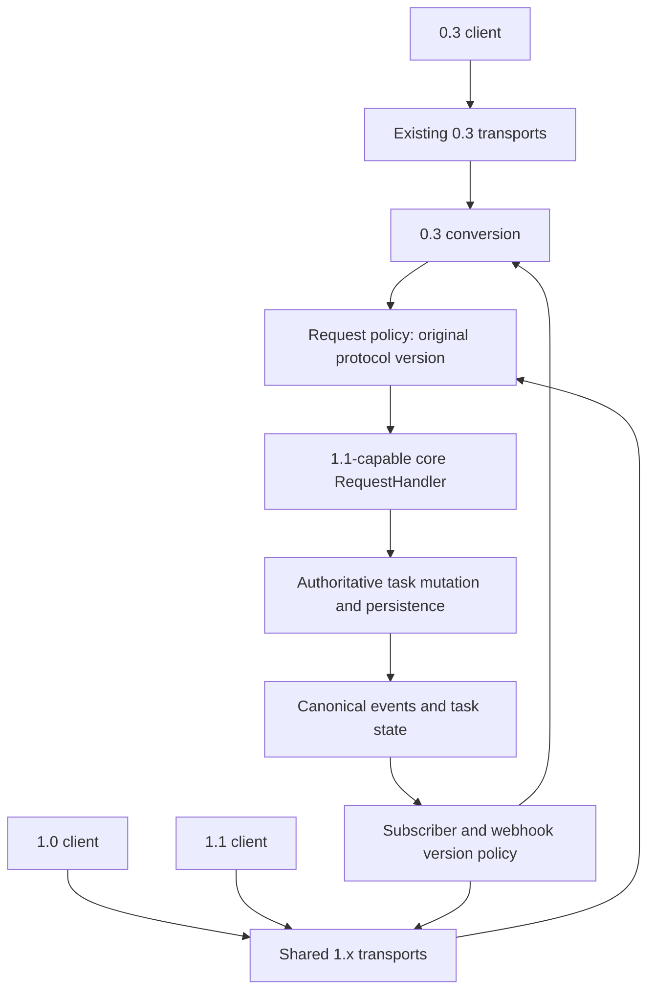

# Sharing a server core across A2A 0.3, 1.0, and 1.1

## Decision under investigation

Can the core move to a 1.1-capable model while continuing to expose a 1.0 server
and a 0.3 server? Yes, based on the current architecture and the RC diff. The
recommended design shares the internal model and execution pipeline, keeps 0.3
conversion, and adds explicit minor-version policy to the 1.x boundary.

This is server coexistence. It does not assume that a 1.0 client sends 1.1
requests, or require new client negotiation machinery. Existing 1.0 and 0.3
clients remain useful as regression-test peers.

## Options

| Option | Benefits | Costs and assessment |
| --- | --- | --- |
| Shared 1.x model and transports, explicit 1.0/1.1 policy | Reuses existing service, handlers, storage, and executor; centralizes mutation invariants | Requires disciplined per-request/per-subscriber policy. Recommended. |
| New `compat-1.0/` model and transport stack translating to 1.1 | Physically separates the old contract; useful if old Java types must be frozen independently | Duplicates mostly unchanged records, schemas, mappers, and tests. Same gRPC service name prevents simply registering both service implementations. Not justified by this diff alone. |
| Preserve the existing 1.0 engine and add an independent 1.1 engine | Strong isolation of implementation behavior | Duplicates task lifecycle and persistence logic and complicates serving one agent. Highest maintenance cost. |

An internal 1.0 adapter or response projector may still be useful under the first
option. The recommendation is against a second full protocol stack, not against
having a clear 1.0 compatibility boundary.

## Current implementation evidence

Paths below are relative to the repository root at the SDK revision recorded in
the [index](README.md). Code is authoritative where older architecture prose
differs.

| Component | Observed behavior | Implication |
| --- | --- | --- |
| `reference/common/.../VersionRouter.java` | Distinguishes 1.0 and 0.3; absent/blank version resolves to 0.3 | Add 1.1 routing while preserving the missing-version rule. |
| `reference/multiversion-{jsonrpc,rest}/` | Dispatches only `isV10` or `isV03` | Both 1.x branches can delegate to core handlers with distinct policies. |
| `server-common/.../ServerCallContext.java` | Carries `requestedProtocolVersion`, transport state, and effective Agent Card | Existing carrier for the selected interface semantics. Preserve the original 0.3 value after conversion. |
| `server-common/.../AgentCardRequestPolicy.java` | Resolves the effective tenant card, validates context/capability, and attaches it | Reuse this boundary for operation/version policy; keep authorization intact. |
| `server-common/.../version/A2AVersionValidator.java` | Requires exact major/minor match with a version found in the card | A card advertising only 1.1 does not automatically enable 1.0. This changed recently upstream; older local-main code allowed any matching major. |
| `compat-0.3/server-conversion/.../Convert_v0_3_To10RequestHandler.java` | Converts requests and delegates to the core `RequestHandler`, then converts results | It can target the evolved core directly; no mandatory 0.3-to-1.0-to-1.1 chain. |
| `compat-0.3/server-conversion/.../mappers/config/A03ToV10MapperConfig.java` | MapStruct unmapped targets are errors | Added core fields need deliberate defaults or ignores; hand-written constructor calls also need review. |
| `server-common/.../tasks/TaskManager.java` | `updateWithMessage` saves directly; agent event persistence goes through the event bus | The current serialization boundary does not cover all 1.1 mutations. |
| `server-common/.../events/MainEventBusProcessor.java` | Persists, triggers replication, sends push, then distributes events | Useful invariant to retain; generation must also reach the emitted event, not only the stored Task. |
| `server-common/.../requesthandlers/DefaultRequestHandler.java` | Subscription prepends a Task snapshot and has no replay store | Replay/cursor behavior needs a new coordinated path. |
| `server-common/.../tasks/PushNotificationConfigStore.java` and `BasePushNotificationSender.java` | Store delivery versions separately and select formatters by version | Reuse and extend for 1.1; current fallback tracks the current-version constant. |

## Proposed shape

The protocol version belongs to the request, subscription, or webhook
configuration. A global current-version flag cannot determine how to format
every response. Nor should an old request force the shared task's internal state
back to an older representation.

## Required version boundaries

### Routing, validation, and discovery

Recognize `1.0` and `1.1` explicitly, route both to the 1.x handler family, and
retain `0.3` dispatch. Validate against the selected interface and effective
tenant rather than treating all 1.x requests as equivalent. The current version
validator collects versions across the card; verify binding/endpoint scoping
when extending it.

The RC prose allows multiple same-transport interfaces with different versions,
while a protobuf comment says to advertise the latest minor per major. Settle
that inconsistency before finalizing discovery. Under the current exact-minor
validator, explicit 1.0 and 1.1 entries are the straightforward coexistence model.
Changing only `AgentInterface.CURRENT_PROTOCOL_VERSION` would lose this distinction.

Gate the new live operation on the requested version as well as streaming
capability. A 1.0 request must not activate 1.1-only operations or semantics.
Retain the established handling of unknown fields where applicable; do not turn
all unknown JSON fields into errors as an incidental compatibility change.

### Shared records and request validation

Evolve core records/builders and protobuf mappers. Preserve deprecated history
fields. Consider overloads for existing record constructors and default methods
or companion interfaces for new handler methods; additive protobuf changes can
still break Java callers and custom `RequestHandler` implementations.

`MessageSendParams` currently enforces a non-null message, and both core send
paths dereference it immediately. 1.1 requires conditional validation: message
is mandatory for task creation, but artifact-only input is allowed for an
existing task. Resolve task identity, tenant, ownership, capability, and write
authorization for that path before touching storage or invoking the executor.
Keep the 1.0 and 0.3 message-required contract at their boundaries.

`onSubscribeToTask` currently accepts `TaskIdParams`, whereas the wire request
gains a cursor. Decide between a dedicated subscription parameter type and an
overload; avoid making unrelated ID-only operations understand replay options.

### One mutation sequence, then per-subscriber projection

Maintain generations and timelines internally for mutations accepted through
all interfaces. Otherwise a 0.3/1.0 mutation could invalidate ordering and
preconditions observed by a 1.1 subscriber. Update the legacy history view at
the same time, preserving existing message-selection semantics and independent
history/timeline length limits.

Keep new client-message events away from 1.0/0.3 subscribers. The RC explicitly
restricts them to 1.1 or later, and existing 0.3 polymorphic mappers throw on
unrecognized core events. Filter before conversion/serialization using a
publisher that handles demand correctly when dropping events; the existing
0.3 `convertPublisher` is a one-item-in/one-item-out mapper.

Ordinary additive fields can be tolerated by conforming peers, so a complete
1.0 DTO tree is not inherently required. A small response projector can omit
1.1-only fields where preserving the existing response shape is desirable.
It must cover unary responses, list results, initial snapshots, streams, and
webhooks consistently. Mixed-version access to tasks containing user artifacts
needs an explicit representation policy; merely dropping `role` can make input
artifacts look like agent outputs to older clients.

### Version-specific errors

The current `spec/.../A2AErrorCodes.java` embeds 1.0.0 HTTP/gRPC mappings, and core
REST/gRPC handlers use them directly. Preserve that behavior for the 1.0
interface unless a separate decision adopts the 1.0.1 corrections. Use the
corrected mappings for 1.1. Keep 0.3's own mapping behavior unchanged.

Prefer a version-aware binding mapper keyed by logical error and request
version over duplicating logical error classes. Cover failures before normal
dispatch as well as normal handler responses. Generation mismatch is a new
logical error, not an alias for task-not-cancelable.

### Live errors and stream lifetime

`TaskState.isInterrupted` and `EventConsumer` already treat interrupted states as
non-terminal. Preserve the distinction between blocking-send completion and
stream completion. Do not add a new close-on-interrupt rule for 1.0 based solely
on an inconsistent sentence in the old specification; freeze existing behavior
with regression tests.

Keep `StreamError` separate from `A2AError` processing. `TaskManager.process`
currently turns an `A2AError` event into task failure. A live input rejection
must instead be scoped to the requesting exchange, leave the task and channel
usable, and not be broadcast as a task mutation to other subscribers. Do not
count it as a generation increment or persist/replicate it as task history.

### gRPC

0.3 retains its distinct `a2a.v1` service. Both 1.x versions share
`lf.a2a.v1.A2AService`, so use one updated service implementation and select
semantics from request metadata. Two full 1.x service registrations with the
same service name are not the equivalent of the existing 0.3 arrangement.
Review existing missing-version defaults in gRPC separately from the HTTP
router; do not silently change them while adding the new minor version.

### Webhook delivery

Extend the existing formatter/store machinery. Select the target version per
configuration, not from whichever request last touched the task. Reconcile the
new public `protocolVersion` field with the existing store-side version metadata;
define precedence and validate supported delivery versions.

Pin old/no-version configurations to the RC's 1.0 fallback. The current fallback
uses `CURRENT_PROTOCOL_VERSION`, which would otherwise change old webhook
payloads when that constant becomes 1.1. Filter new event kinds before 0.3
formatting too: the current 0.3 formatter accepts task snapshots for most event
types and could otherwise send extra notifications for new message events.

## What changes in compat-0.3

1. Keep its wire records, generated package, public client API, and transport
   contracts at 0.3. Change only its connection to the evolving core.
2. Map absent 1.1 options to absent/default values. Do not synthesize a concurrency
   condition, replay cursor, or user artifacts for an old request.
3. Maintain old history conversion; omit generation/timeline-only data on the
   old wire. Preserve the existing blocking inversion and history-length rules.
4. Suppress unrepresentable new events before the conversion mapper and preserve
   the existing error and webhook behavior.
5. Retain original version context and relaxed context-ID validation. Renaming
   `To10` classes/configuration is optional cleanup and should account for public
   API compatibility; their name does not force use of a 1.0 intermediate model.

No separate 1.0 engine is necessary just to service that adapter.

## Core work required regardless of compatibility packaging

- Put client-message acceptance and agent status/artifact mutation under a
  common authoritative ordering mechanism. A process-local bus alone does not
  provide cross-node atomicity. The current TaskStore get/save contract does
  not expose atomic compare-and-mutate.
- Persist the resulting task and publish the corresponding stamped event
  consistently. MainEventBusProcessor currently distributes the original event;
  incrementing only the Task generation would leave clients with wrong values.
- Preserve assigned generations on replicated events and deduplicate replays.
  Inspect synthesized final status events in replicated queue handling as well
  as the normal replication hook. Do not assign a fresh generation per node.
- Coordinate snapshot, replay, and live subscription at a watermark to avoid
  gaps/duplicates. Existing queues contain future events, not a replay log.
- A bounded event journal can support replay; snapshot fallback avoids requiring
  indefinite retention. Durable replay across restart is a separate choice.
- Define how live input reaches a running AgentExecutor. Repeatedly invoking the
  current send handler is not a complete live-session design; it also starts
  execution and manages per-call queue/cleanup state.

These changes warrant focused design before implementation. The next document
records [acceptance scenarios and unresolved decisions](validation.md).

## Source navigation

These links identify the inspected implementation points at this branch's base:

- [VersionRouter](../../../reference/common/src/main/java/org/a2aproject/sdk/server/common/quarkus/VersionRouter.java),
  [JSON-RPC dispatch](../../../reference/multiversion-jsonrpc/src/main/java/org/a2aproject/sdk/server/multiversion/jsonrpc/MultiVersionJSONRPCRoutes.java),
  [REST dispatch](../../../reference/multiversion-rest/src/main/java/org/a2aproject/sdk/server/multiversion/rest/MultiVersionRestRoutes.java).
- [ServerCallContext](../../../server-common/src/main/java/org/a2aproject/sdk/server/ServerCallContext.java),
  [request policy](../../../server-common/src/main/java/org/a2aproject/sdk/server/AgentCardRequestPolicy.java),
  [version validator](../../../server-common/src/main/java/org/a2aproject/sdk/server/version/A2AVersionValidator.java).
- [RequestHandler](../../../server-common/src/main/java/org/a2aproject/sdk/server/requesthandlers/RequestHandler.java),
  [DefaultRequestHandler](../../../server-common/src/main/java/org/a2aproject/sdk/server/requesthandlers/DefaultRequestHandler.java),
  [MessageSendParams](../../../spec/src/main/java/org/a2aproject/sdk/spec/MessageSendParams.java),
  [TaskIdParams](../../../spec/src/main/java/org/a2aproject/sdk/spec/TaskIdParams.java).
- [0.3 conversion handler](../../../compat-0.3/server-conversion/src/main/java/org/a2aproject/sdk/compat03/conversion/Convert_v0_3_To10RequestHandler.java),
  [mapper configuration](../../../compat-0.3/server-conversion/src/main/java/org/a2aproject/sdk/compat03/conversion/mappers/config/A03ToV10MapperConfig.java),
  [streaming event mapper](../../../compat-0.3/server-conversion/src/main/java/org/a2aproject/sdk/compat03/conversion/mappers/domain/StreamingEventKindMapper_v0_3.java),
  [Task mapper](../../../compat-0.3/server-conversion/src/main/java/org/a2aproject/sdk/compat03/conversion/mappers/domain/TaskMapper_v0_3.java).
- [TaskManager](../../../server-common/src/main/java/org/a2aproject/sdk/server/tasks/TaskManager.java),
  [TaskStore](../../../server-common/src/main/java/org/a2aproject/sdk/server/tasks/TaskStore.java),
  [MainEventBusProcessor](../../../server-common/src/main/java/org/a2aproject/sdk/server/events/MainEventBusProcessor.java),
  [EventConsumer](../../../server-common/src/main/java/org/a2aproject/sdk/server/events/EventConsumer.java),
  [TaskState](../../../spec/src/main/java/org/a2aproject/sdk/spec/TaskState.java).
- [Error mappings](../../../spec/src/main/java/org/a2aproject/sdk/spec/A2AErrorCodes.java),
  [REST handler](../../../transport/rest/src/main/java/org/a2aproject/sdk/transport/rest/handler/RestHandler.java),
  [gRPC handler](../../../transport/grpc/src/main/java/org/a2aproject/sdk/transport/grpc/handler/GrpcHandler.java).
- [Push config store](../../../server-common/src/main/java/org/a2aproject/sdk/server/tasks/PushNotificationConfigStore.java),
  [push sender](../../../server-common/src/main/java/org/a2aproject/sdk/server/tasks/BasePushNotificationSender.java),
  [0.3 formatter](../../../compat-0.3/server-conversion/src/main/java/org/a2aproject/sdk/compat03/conversion/PushNotificationPayloadFormatter_v0_3.java).
- [JPA task store](../../../extras/task-store-database-jpa/src/main/java/org/a2aproject/sdk/extras/taskstore/database/jpa/JpaDatabaseTaskStore.java),
  [JPA Task representation](../../../extras/task-store-database-jpa/src/main/java/org/a2aproject/sdk/extras/taskstore/database/jpa/JpaTask.java),
  [replicated queue manager](../../../extras/queue-manager-replicated/core/src/main/java/org/a2aproject/sdk/extras/queuemanager/replicated/core/ReplicatedQueueManager.java),
  [replicated event representation](../../../extras/queue-manager-replicated/core/src/main/java/org/a2aproject/sdk/extras/queuemanager/replicated/core/ReplicatedEventQueueItem.java).
- [Gson stream adapter](../../../jsonrpc-common/src/main/java/org/a2aproject/sdk/jsonrpc/common/json/JsonUtil.java),
  [protobuf stream mapper](../../../spec-grpc/src/main/java/org/a2aproject/sdk/grpc/mapper/StreamResponseMapper.java).
